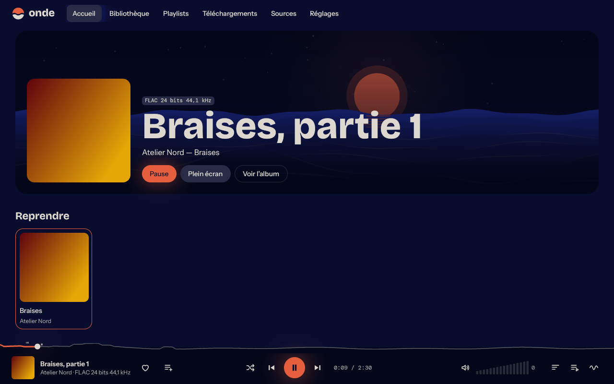
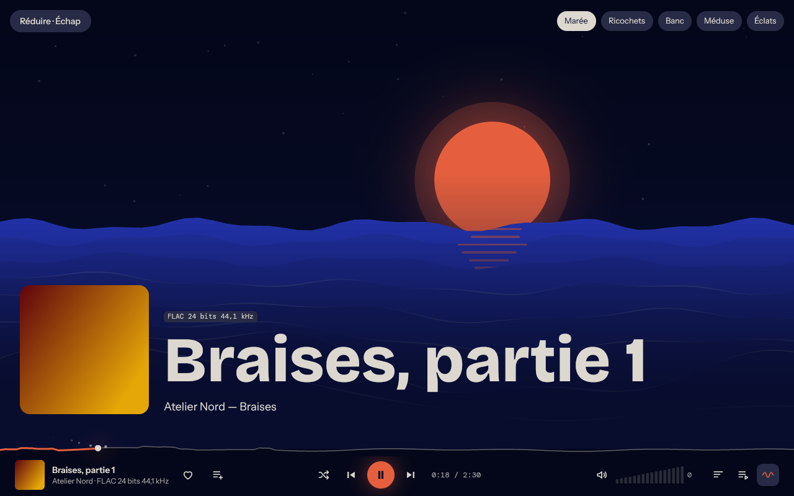

<div align="center">

# 🌊 Onde

**Toute ta musique au même endroit, dans une vraie appli native.**

Un lecteur de musique en Rust et GPUI, sans Electron : ta bibliothèque, ton serveur Navidrome, tes téléchargements et des visuels qui réagissent au son.

[](https://github.com/dontleteuwatchyou/onde/releases/latest)
[](LICENSE)


[](https://ko-fi.com/forsakengh)



</div>

## Installation

```bash
curl -fsSL https://raw.githubusercontent.com/dontleteuwatchyou/onde/master/install.sh | sh
```

Le script télécharge la dernière version, vérifie sa somme de contrôle et installe Onde pour ton utilisateur, sans `sudo`. Onde apparaît aussi dans ton lanceur d'applications.

Lance ensuite la commande `onde`. Si elle est introuvable, ajoute `~/.local/bin` à ton `PATH`.

Pour désinstaller Onde (ta musique et tes réglages restent en place) :

```bash
curl -fsSL https://raw.githubusercontent.com/dontleteuwatchyou/onde/master/install.sh | sh -s -- --uninstall
```

### Ce qu'il faut sur ton système

La version compilée vise Linux x86_64 et a été construite sous Arch Linux. Avec une glibc plus ancienne, compile depuis les sources.

Sous Arch :

```bash
sudo pacman -S --needed alsa-lib libxcb libxkbcommon libxkbcommon-x11 vulkan-icd-loader wayland
```

Il te faut aussi le pilote Vulkan de ta carte graphique : `vulkan-radeon`, `vulkan-intel` ou `nvidia-utils`.

Pour télécharger depuis YouTube et SoundCloud, ajoute `yt-dlp` et `ffmpeg` :

```bash
sudo pacman -S --needed yt-dlp ffmpeg
```

### Depuis les sources

```bash
sudo pacman -S --needed base-devel rustup cmake pkgconf fontconfig freetype2 alsa-lib libxcb libxkbcommon libxkbcommon-x11 vulkan-icd-loader wayland
```

```bash
rustup default stable
```

```bash
git clone https://github.com/dontleteuwatchyou/onde && cd onde && cargo build --release
```

```bash
./target/release/onde
```

## Ce qu'Onde sait faire

| | |
|---|---|
| 🎵 **Lecture** | Fichiers locaux, format réel affiché (FLAC 24 bits, 96 kHz…), lecture aléatoire |
| 📚 **Bibliothèque** | Morceaux, albums, artistes, tri et recherche |
| ❤️ **Collections** | Titres likés et playlists, qui survivent à un nouveau scan |
| 🖧 **Navidrome** | Ton serveur Subsonic ou Navidrome comme source |
| ⬇️ **Téléchargements** | YouTube et SoundCloud avec `yt-dlp`, Live Music Archive, et Telegram en option |
| 🎤 **Paroles** | Paroles synchronisées quand elles existent |
| 🌊 **Visuels** | Marée, Ricochets, Banc, Méduse et Éclats réagissent à la musique |
| 🎨 **Thèmes** | Sept thèmes sombres et un thème clair |
| 🎮 **Discord** | Le morceau en cours sur ton profil, avec sa pochette et son temps |

<div align="center">

</div>

## Premiers pas

1. Au premier lancement, Onde te demande ton dossier de musique.
2. Pour ajouter ton serveur, va dans **Sources** ou appuie sur `N`.
3. Pour changer de visuel ou de thème, va dans **Réglages**.

## Raccourcis

| Touche | Action |
|---|---|
| `Espace` | Lecture ou pause |
| `Ctrl` + `←` / `→` | Morceau précédent ou suivant |
| `←` / `→` | Reculer ou avancer |
| `↑` / `↓` | Volume |
| `S` | Lecture aléatoire |
| `H` | Liker le morceau en cours |
| `F` | Plein écran |
| `L` | Paroles |
| `V` | Visuels, puis visuel suivant |
| `Q` | File d'attente |
| `D` | Téléchargements |
| `/` | Chercher dans la bibliothèque |
| `N` | Ouvrir Navidrome |
| `Échap` | Fermer, quitter le plein écran |

## Options

### Discord

C'est désactivé tant que tu ne l'as pas configuré.

1. Sur [discord.com/developers](https://discord.com/developers/applications), crée une application nommée « Onde ».
2. Copie son **Application ID**.
3. Dans Onde, va dans **Réglages → Discord** et clique sur **Coller l'identifiant**.

Discord doit être ouvert sur la même machine.

### Telegram

Cette source facultative passe par ton compte Telegram et un bot tiers, @DeezLoad2Bot. Rien ne démarre tant que tu ne l'as pas acceptée dans Onde.

> [!WARNING]
> Onde n'est pas lié à ce bot et ne vérifie pas les droits sur les fichiers qu'il renvoie. Ne demande que ce que tu as le droit de télécharger. Le bot reçoit tes recherches et les informations de profil exposées par Telegram. La session créée dans `~/.config/onde/telegram` donne accès à ton compte : ne la partage jamais.

**1.** Installe les dépendances Python :

```bash
python3 -m venv ~/.local/share/onde/telegram-venv
```

```bash
~/.local/share/onde/telegram-venv/bin/pip install -r https://raw.githubusercontent.com/dontleteuwatchyou/onde/master/integrations/telegram/requirements.txt
```

**2.** Crée ton identifiant d'application sur [my.telegram.org](https://my.telegram.org), puis mets-le dans `~/.config/onde/telegram/api.env` :

```
ONDE_TELEGRAM_API_ID=ton_id
ONDE_TELEGRAM_API_HASH=ton_hash
```

**3.** Protège ce fichier :

```bash
chmod 600 ~/.config/onde/telegram/api.env
```

**4.** Dans **Téléchargements → Telegram**, accepte les permissions et scanne le QR depuis Telegram, dans **Paramètres → Appareils**.

Ensuite, Entrée affiche les résultats et un clic sur une musique la télécharge dans ton dossier de musique, dès que le bot l'a préparée. Le choix d'un résultat poste un message dans ton chat avec le bot. Onde se reconnecte tout seul à chaque lancement. **Supprimer la session** dans le panneau revient en arrière ; révoque-la aussi dans Telegram. Le détail est dans [`design/telegram-source-review.md`](design/telegram-source-review.md).

## Ta vie privée

Onde n'a ni compte, ni pisteur, ni télémétrie. Seules ces fonctions contactent des services :

| Quand | Ce qui part | Vers |
|---|---|---|
| Paroles | Titre, artiste, album, durée | lrclib.net |
| Recherche et téléchargement | Ce que tu cherches | La source choisie |
| Navidrome | Tes identifiants et tes demandes | Ton serveur |
| Telegram activé | Tes recherches et les résultats choisis | Telegram et @DeezLoad2Bot |
| Discord activé | Titre, artiste, album | Discord |
| Recherche de pochette pour Discord | Artiste, album, titre | Apple Music, puis Deezer |
| Pochette introuvable | La pochette seule, réduite, pendant 24 h | litterbox.catbox.moe |
| « Héberger toutes les pochettes » activé | Toutes les pochettes, réduites, **sans suppression possible** | catbox.moe |

Les images hébergées sont visibles par toute personne qui a leur lien.

## Compatibilité

| Système | État |
|---|---|
| Linux, Wayland (Hyprland) | ✅ Utilisé au quotidien |
| Linux, X11 | ❓ Pas testé |
| Windows | ❌ Le code utilise des fonctions propres à Unix |
| macOS | ❌ Pas pris en charge |

## Soutenir

Si Onde te rend service, [un café](https://ko-fi.com/forsakengh) m'aide à continuer.

## Licence

Onde est sous licence [MIT](LICENSE). Les polices restent sous licence SIL OFL (`assets/fonts`), et les dépendances Python du pont Telegram sous leurs propres licences (`integrations/telegram/licenses`).
